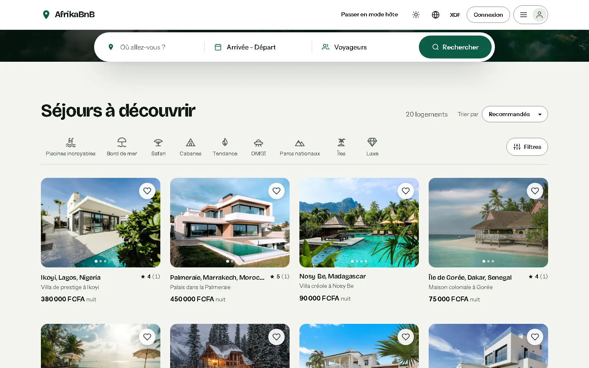
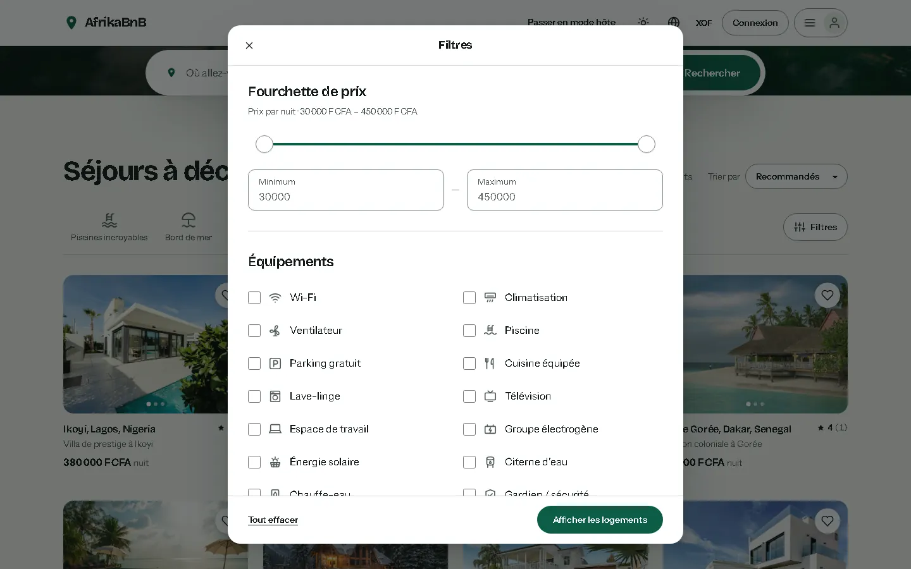
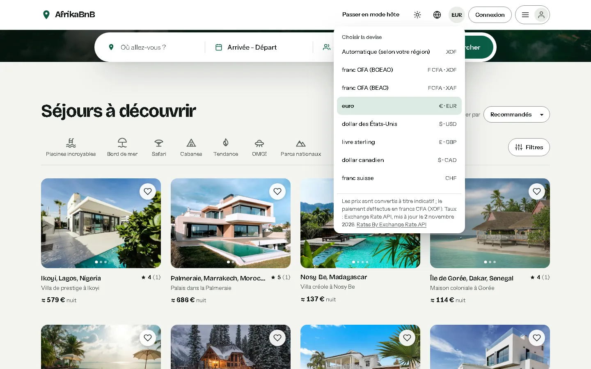
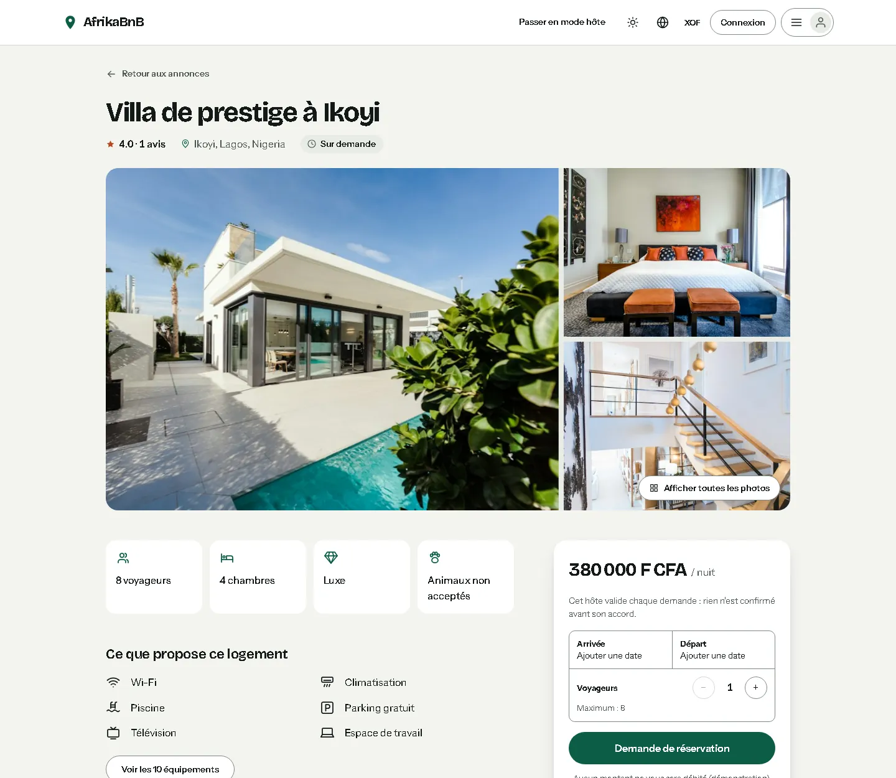
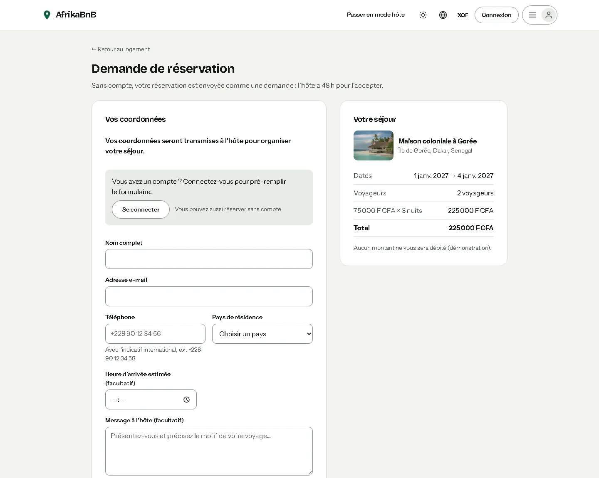
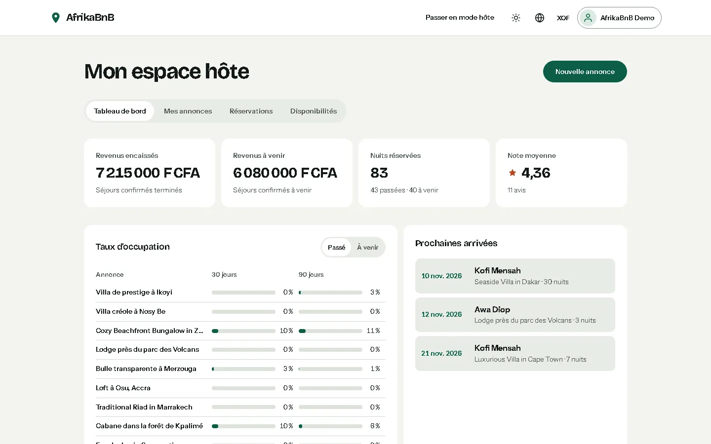
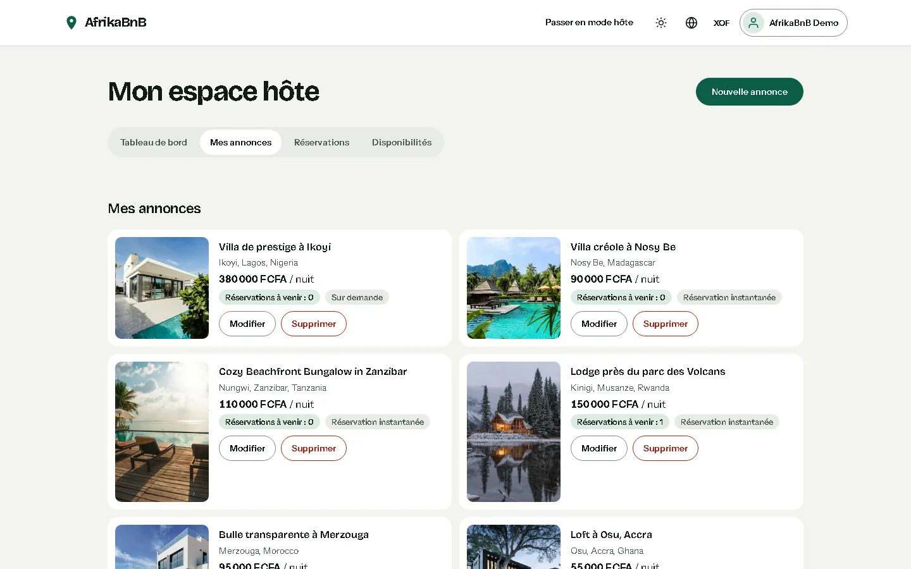
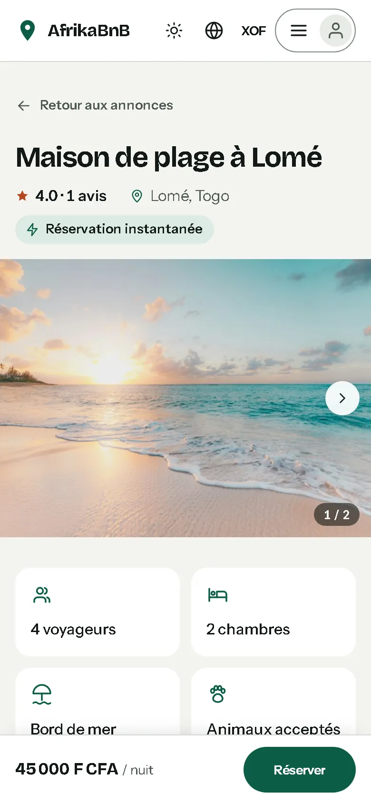

# AfrikaBnB

Plateforme de réservation de logements en Afrique, sur le modèle d’Airbnb. Projet étudiant / portfolio réalisé à Lomé (Togo).

- **Frontend** : React 19 (Vite), à la racine du dépôt.
- **Backend** : API REST Node.js / Express + Prisma + PostgreSQL (hébergé sur Supabase), dans `backend/` (documentation détaillée des endpoints : [`backend/README.md`](backend/README.md)).


---

## Aperçu

Captures du site en local avec les données de démonstration.

### Recherche et annonces



| Filtres (prix, équipements) | Devise d’affichage selon la région |
|---|---|
|  |  |

### Fiche logement et réservation





### Espace hôte

| Tableau de bord | Mes annonces |
|---|---|
|  |  |

### Mode sombre et mobile


<p>
  
  &nbsp;
  
</p>

---

## Stack

| Couche | Technologies |
|---|---|
| Frontend | React 19, Vite 8, react-router 7, Context API, CSS |
| Backend | Node.js, Express 4 (modules ESM), Prisma 5, zod, jsonwebtoken, bcryptjs, helmet, express-rate-limit |
| Base de données | PostgreSQL (Supabase en production ; PostgreSQL 16 en local via Docker, facultatif) |
| Services externes | Google Maps JavaScript API / Places (optionnel, après consentement), OpenStreetMap Nominatim (géocodage côté serveur), images Unsplash |
| Conteneurs | Image Docker de l’API ; Docker Compose : API + PostgreSQL local (le frontend n’est pas conteneurisé) |

100 % JavaScript (pas de TypeScript). Le backend est un **monolithe modulaire** : une seule application Express découpée par domaine (`backend/src/api/{auth,users,listings,bookings,reviews,favorites,maps}`).

---

## Fonctionnalités

- **Recherche** : destination (insensible à la casse et aux accents : « Lome » trouve Lomé), dates (exclut les logements réservés ou bloqués), voyageurs, catégories, **filtres** prix et équipements, **tri** ; critères synchronisés dans l’URL.
- **Fiche logement** : galerie et visionneuse plein écran, équipements, réservation instantanée ou **sur demande** (l’hôte accepte ou refuse sous 48 h), dates indisponibles bloquées, contrôle anti double-réservation côté serveur.
- **Réservation sans compte** : formulaire de contact (nom, e-mail, téléphone, pays, heure d’arrivée, message) transmis à l’hôte, lien personnel pour suivre ou annuler ; pré-rempli pour les membres.
- **Devise d’affichage** détectée selon la langue et le fuseau du navigateur (sans géolocalisation tierce), modifiable ; prix convertis à titre indicatif, montant facturé en francs CFA.
- **Paiement Mobile Money** via CinetPay (désactivé par défaut, voir `DEPLOY.md`).
- **Compte** : sessions par cookie httpOnly avec renouvellement, mot de passe oublié par e-mail, « se déconnecter de tous les appareils », profil, réservations et statuts, avis après le séjour, favoris.
- **Espace hôte** (`/host`) : tableau de bord (revenus, taux d’occupation, prochaines arrivées), annonces avec photos par glisser-déposer, réservations reçues avec fiche de contact, périodes bloquées.
- **Administration** (`/admin`) : utilisateurs et rôles, modération des annonces et des avis, remboursements.
- **Carte** (`/carte`) : Google Maps avec marqueurs de prix ; repli en liste sans clé API ou sans consentement.
- **Interface** : 5 langues (français, anglais, espagnol, allemand, portugais), mode sombre, adaptée au mobile, installable (PWA).
- **Vie privée** : bandeau de consentement (Google Fonts et Maps chargés seulement après acceptation), pages légales (mentions, confidentialité, cookies, CGU).

---

## Prérequis

- Node.js et npm
- Un projet [Supabase](https://supabase.com) (offre gratuite suffisante), **ou** Docker (Docker Compose) pour lancer PostgreSQL et l’API en local
- `openssl` (pour générer le secret JWT)
- Optionnel : une clé Google Maps (Maps JavaScript API + Places API)

---

## Installation

### 1. Backend

```bash
cd backend
npm install
cp .env.example .env
```

Éditer `backend/.env` :

- `DATABASE_URL` : URL **Transaction pooler** Supabase (port `6543`) suivie de `?pgbouncer=true&connection_limit=1&sslmode=require` ;
- `DIRECT_URL` : URL **Session pooler** (ou **Direct connection**) Supabase (port `5432`) suivie de `?sslmode=require` (utilisée par les migrations) ;
- `JWT_SECRET` : coller la sortie de `openssl rand -base64 48` (32 caractères minimum ; l’API refuse de démarrer en production si le secret est absent ou faible).

Créer le schéma, générer le client Prisma, charger les données de démo et lancer l’API :

```bash
npx prisma migrate deploy
npx prisma generate
npm run db:seed
npm run dev
```

L’API écoute sur **http://localhost:4000** (`GET /health` pour vérifier). Procédure Supabase détaillée (création du projet, où trouver les URL, sauvegardes, sécurité) : [`backend/README.md`](backend/README.md#base-de-données-supabase).

**Avec Docker** (API + PostgreSQL local) : voir [`backend/README.md`](backend/README.md) (`docker compose up --build` depuis `backend/`, après avoir renseigné `JWT_SECRET` et `POSTGRES_PASSWORD` dans `backend/.env`).

### 2. Frontend

Dans un second terminal, à la racine du dépôt :

```bash
npm install
npm run dev
```

L’application tourne sur **http://localhost:3000**. En développement, le proxy de `vite.config.js` redirige `/api/*` (et `/health`) vers `http://localhost:4000` : aucune variable n’est obligatoire.

Variables optionnelles (fichier `.env` à la racine, modèle : `.env.example`) :

| Variable | Rôle |
|---|---|
| `VITE_GOOGLE_MAPS_API_KEY` | Active l’autocomplétion des destinations et la carte Google. Sans clé, la page `/carte` affiche une liste. |
| `VITE_API_URL` | URL de l’API à utiliser à la place du proxy (backend sur une autre machine / un autre port). |

Si l’API est injoignable, l’accueil affiche des annonces de démonstration statiques (`src/data/listings.js`).

---

## Comptes de démo

Créés par `npm run db:seed` (refusé si `NODE_ENV=production`). Mot de passe commun : `demo1234`.

| E-mail | Rôle |
|---|---|
| `host@afrikabnb.com` | Hôte |
| `awa@afrikabnb.com` | Hôte |
| `kofi@afrikabnb.com` | Voyageur |

Aucun compte administrateur n'utilise ce mot de passe public. Pour en créer un, définir `SEED_ADMIN_PASSWORD` (12 caractères minimum) dans `backend/.env` avant le seed, ou lancer `node scripts/rotate-admin-password.mjs` dans `backend/` pour remplacer le mot de passe d'un admin existant (il est écrit uniquement dans `.env`).

Le seed est idempotent (relançable sans doublon) : 20 annonces réparties sur les 9 catégories, des réservations passées et à venir, et des avis.

> Ces comptes et ce mot de passe sont réservés à la démo locale : ne jamais les utiliser en production.

---

## Tests et qualité

| Commande | Où | Contenu |
|---|---|---|
| `npm test` | racine | Vitest + Testing Library, exécution unique (`npm run test:watch` pour le mode watch) : 214 tests |
| `npm test` | `backend/` | `node --test` : 22 tests sur la logique métier (nuits, prix, chevauchement de dates, moyenne des notes, filtres de recherche) |
| `npm run build` | racine | Build de production dans `build/` |
| `npm run lint` | racine | ESLint (config plate `eslint.config.js` : règles react-app, hooks, accessibilité JSX ; `src/`, `e2e/` et `playwright.config.js`) |
| `npm run e2e:readonly` | racine | Playwright, parcours en **lecture seule** (`@readonly`) dans un vrai Chromium, contre les serveurs de développement |
| `npm run e2e` | racine | Playwright, suite complète (écrit dans la base) : **CI uniquement** (workflow `e2e.yml`) |
| `npm audit` | `backend/` | 0 vulnérabilité au 21/10/2026 |

### Tests de bout en bout (Playwright)

Les tests sont dans `e2e/` (config `playwright.config.js` : Chromium, `baseURL` http://localhost:3000, langue forcée en français, bandeau cookies refusé au début de chaque parcours, traces et captures conservées en cas d'échec, projet mobile 390 px pour les parcours tagués `@mobile`). Vitest ne les ramasse pas (`test.include` limité à `src/`).

**En local : lecture seule uniquement.** La base de développement (Supabase) est partagée : seuls les parcours `@readonly` (accueil, recherche « Lome » → Lomé, catégories, panneau Filtres et tri, fiche logement et visionneuse au clavier, `/carte`, devise d'affichage, langue, pages légales, 404, mode sombre, absence d'erreurs console et de débordement horizontal en 390 px) s'exécutent sur un poste. Ils n'envoient que des lectures à l'API.

```bash
npx playwright install chromium   # une fois (ou E2E_CHANNEL=msedge pour utiliser Edge installé)
npm run dev                       # frontend :3000 ; backend démarré à part (cd backend && npm run dev)
npm run e2e:readonly              # = npx playwright test --grep @readonly
```

**Suite complète : CI uniquement.** Les autres parcours écrivent dans la base : inscription et restauration de session par le cookie httpOnly, déconnexion, favoris, réservation instantanée puis annulation, réservation sans compte et lien de suivi, refus d'une demande par l'hôte (fiche de contact), mot de passe oublié (lien relevé dans la sortie console du backend), création et suppression d'une annonce avec photo, administration (si `SEED_ADMIN_PASSWORD` est défini). Ils tournent dans `.github/workflows/e2e.yml` sur une base PostgreSQL 16 jetable (migrations + seed, secrets générés dans le job). Garde-fou : hors CI, `playwright.config.js` ne retient que les tests `@readonly`, même avec `npm run e2e` (sauf `E2E_ALLOW_WRITE=1`, à réserver à une base locale jetable). En CI, le backend tourne avec `TRUST_PROXY=1` et chaque test présente une adresse `X-Forwarded-For` fictive, pour que les limites de débit de l'API ne s'appliquent pas à toute la suite d'un coup. En cas d'échec, le rapport HTML, les traces et les logs des serveurs sont publiés en artefact `playwright-report`.

Taille du build (gzip) : bundle principal ≈ 119 kB (Vite 8), sans autre chunk significatif (la scène 3D three.js a été retirée le 22/10/2026).

---

## Structure du dépôt

```
afrikabnb/
├── index.html              # point d’entrée Vite (meta SEO, manifest)
├── vite.config.js          # Vite : proxy /api, build, config Vitest
├── public/                 # favicon, manifest, robots.txt, llms.txt
├── src/
│   ├── api/client.js       # appels à l’API
│   ├── components/         # UI : recherche, cartes, booking/, host/, profile/, map/, Hero (bandeau d’accueil)
│   ├── context/            # Auth, Consent, Favorites, Language (+ translations.js), Search
│   ├── data/listings.js    # annonces de repli (API injoignable)
│   ├── hooks/              # useGoogleMapsScript (chargement conditionné au consentement)
│   ├── pages/              # Home, PropertyDetails, Host, Profile, Favorites, MapPage, legal/
│   └── utils/
└── backend/
    ├── src/
    │   ├── api/            # un dossier par domaine (auth, users, listings, bookings, reviews, favorites, maps)
    │   ├── config/         # env.js (validation de l’environnement), jwt.js, db.js
    │   ├── middleware/     # auth, validation zod, gestion des erreurs
    │   └── utils/
    ├── prisma/             # schema.prisma, migrations/, seed.js
    ├── test/               # tests node --test
    ├── Dockerfile
    └── docker-compose.yml
```

---

## Limites connues et pistes

| Limite | Piste |
|---|---|
| Pas de paiement en ligne | Intégrer un prestataire (mobile money, carte) |
| Pas de messagerie hôte / voyageur | Ajouter un domaine `messages` |
| Une seule image par annonce (URL) | Galerie et upload d’images |
| Token JWT stocké en `localStorage` (exposé en cas de XSS) | Cookie `httpOnly` + refresh token |
| Modes de calendrier « Mois » / « Flexibles » non implémentés (affichent « à venir ») ; l’option de flexibilité ±jours n’est pas prise en compte par la recherche | Implémenter côté API et UI |
| Déploiement du frontend non décrit (pas de conteneur) | Hébergement statique du `build/` + `VITE_API_URL` |
| Index géographique : index B-tree composite `(latitude, longitude)`, pas un index `SPATIAL` | Extension PostGIS (disponible sur Supabase) si le volume l’exige |
